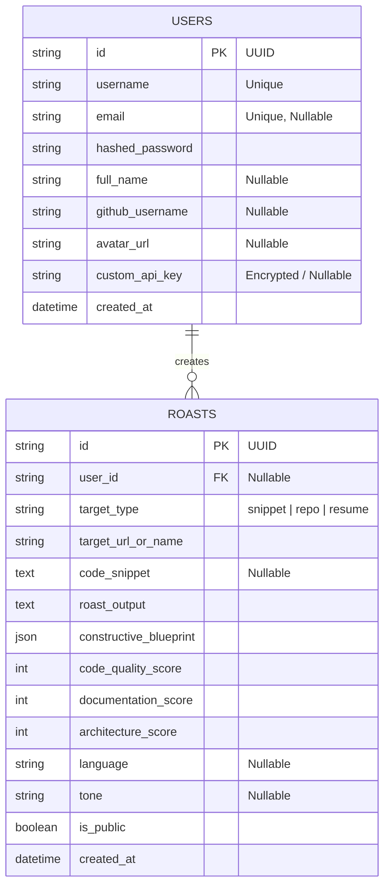

# 🔥 RoastMyCode — Full-Stack AI Engineering & Code Critique Platform

[](https://fastapi.tiangolo.com)
[](https://nextjs.org)
[](https://groq.com)
[](https://python.org)
[](https://www.typescriptlang.org)
[](https://tailwindcss.com)
[](https://opensource.org/licenses/MIT)

> **"Because your linter is too polite, and your colleagues are too tired to tell you the truth."**  
> An intelligent, sarcastic, LLM-powered developer evaluation platform that critiques code snippets, GitHub repositories, and developer resumes — pairing brutal comedic roasts with actionable, production-grade refactoring blueprints.

---

## 📑 Table of Contents

1. [Project Overview & Executive Summary](#-project-overview--executive-summary)
2. [Problem Statement & Motivation](#-problem-statement--motivation)
3. [Key Features & Capabilities](#-key-features--capabilities)
4. [System Architecture & Data Flow](#-system-architecture--data-flow)
5. [AI & LLM Inference Pipeline](#-ai--llm-inference-pipeline)
6. [Resilient Dual-Engine Design](#-resilient-dual-engine-design)
7. [Database Schema & Data Model](#-database-schema--data-model)
8. [API Reference & Endpoint Directory](#-api-reference--endpoint-directory)
9. [Tech Stack & Engineering Justifications](#-tech-stack--engineering-justifications)
10. [Local Development & Setup Guide](#-local-development--setup-guide)
11. [Docker Deployment](#-docker-deployment)
12. [Configuration & Environment Variables](#-configuration--environment-variables)
13. [Testing & Quality Assurance](#-testing--quality-assurance)
14. [Repository File Map](#-repository-file-map)
15. [Academic Project Report Summary](#-academic-project-report-summary)
16. [Future Scope & Roadmap](#-future-scope--roadmap)

---

## 🎯 Project Overview & Executive Summary

**RoastMyCode** is a full-stack, cloud-native web application designed to evaluate engineering artifacts across three key verticals:
1. **Raw Code Snippets**: Instant linting, bad-practice detection, time-complexity analysis, and structural decomposition.
2. **GitHub Repositories**: End-to-end repository health assessment, evaluating commit habits, architectural modularity, test suite presence, and documentation completeness.
3. **Developer Resumes (PDF)**: Automated text parsing of CVs, auditing metric density, corporate buzzword overuse, and alignment with the Google XYZ achievement formula.

Unlike standard static analysis tools that spit out cold compiler errors or conventional chatbots that offer generic sycophancy, RoastMyCode delivers **engaging, sarcastic feedback** combined with a **concrete, multi-step engineering blueprint** to elevate the project to production-grade quality.

---

## 💡 Problem Statement & Motivation

Traditional code review and career preparation face critical human and tooling bottlenecks:
- **Linter Fatigue**: Static analyzers (ESLint, Flake8) highlight syntax and formatting but cannot understand domain semantics, business-rule coupling, or architectural anti-patterns.
- **Sterile AI Advice**: Generic ChatGPT prompts yield boilerplate praise without pinpointing sloppy shortcuts (e.g., hardcoded secrets, lack of error boundaries, O(n³) loops).
- **Vague Resumes**: Software engineering candidates frequently write task-oriented CVs ("participated in agile meetings", "used Python") without quantifiable metrics or architectural proof.
- **Reviewer Burnout**: Senior engineers lack the time to provide humorous, memorable feedback that actually sticks with junior developers.

**RoastMyCode** addresses this by gamifying code review with sharp wit while maintaining rigorous architectural guidance and zero-downtime reliability.

---

## ✨ Key Features & Capabilities

### 1. Snippet Roast Studio
- Direct code editor supporting syntax detection for Python, TypeScript, JavaScript, Go, Rust, Java, C++, and more.
- Persona/Tone selection:
  - `senior_dev` (The battle-hardened Staff Architect)
  - `linus_torvalds` (Zero tolerance for bad code)
  - `recruiter` (ATS filter looking for red flags)
  - `gordon_ramsay` (Kitchen nightmares, but for software)
- Independent tripartite scoring (0–100):
  - **Code Quality Score** (cleanliness, safety, idiomatic conventions)
  - **Documentation Score** (clarity, naming intent, comments)
  - **Architecture Score** (separation of concerns, algorithmic complexity)

### 2. GitHub Repository Auditor
- Ingests public repositories via `owner/repo` or full URL.
- Inspects repository metadata:
  - Commit velocity and messaging quality (e.g., detecting `fix`, `update`, `asdasd`).
  - Directory structure depth and modularity.
  - Test coverage footprint (detecting presence of `tests/`, `__tests__/`, `pytest.ini`).
  - CI/CD presence (`.github/workflows`).
  - Dependency freshness and documentation hygiene (`README.md`).

### 3. Developer Resume PDF Analyzer
- Client-side drag-and-drop PDF upload with 5MB validation.
- Server-side byte extraction using `pypdf`.
- Evaluates:
  - **Buzzword Overuse**: Flags words like *"ninja"*, *"rockstar"*, *"passionate"*, *"synergy"*.
  - **Metric Density**: Scans for quantifiable indicators (percentages, dollar savings, latency decreases, throughput gains).
  - **Google XYZ Formula Alignment**: Translates attendance-based bullets into *"Accomplished [X], measured by [Y], by doing [Z]"*.

### 4. User System & BYOK (Bring Your Own Key)
- JWT-based authentication (`/api/v1/auth/register`, `/api/v1/auth/login`).
- User profile management with personal roast history.
- **BYOK Support**: Users can supply their personal Groq API key in the UI settings for higher individual rate limits without platform constraints.

### 5. Community "Hall of Flame"
- Public showcase of the most brutally roasted repositories and snippets.
- Global statistics: Total roasts generated, average quality scores, and most roasted languages.

### 6. Minimalist & Elegant Engineering UI
- **Refined Dark Palette**: Purpose-built Zinc & Slate theme (`#09090b` base) designed for developer focus without eye strain or visual noise.
- **Hairline Borders & Subtle Shadows**: Tactile micro-borders (`border-white/5`, `border-zinc-800`) replacing loud neon glow filters.
- **Segmented Studio Controls**: Clean pill navigation across GitHub repos, raw snippets, and PDF uploads.
- **Precision Gauges & Checklists**: Fine-stroke circular metrics (5px SVG track) and interactive senior architect blueprint checklists.

---

## 🏛 System Architecture & Data Flow

```
                                  ┌─────────────────────────────┐
                                  │      Client Browser         │
                                  │   (Next.js 14 App Router)   │
                                  └──────────────┬──────────────┘
                                                 │
                                     HTTP / REST │ JSON / Form-Data
                                                 ▼
┌────────────────────────────────────────────────────────────────────────────────┐
│                             FastAPI Gateway Backend                             │
│                                                                                │
│   ┌────────────────────────────────────────────────────────────────────────┐   │
│   │                              Routers                                   │   │
│   │  /api/v1/auth           /api/v1/roast/snippet    /api/v1/roast/github  │   │
│   │  /api/v1/roast/resume   /api/v1/roast/history    /api/v1/roast/public  │   │
│   └───────────────────────────────────┬────────────────────────────────────┘   │
│                                       │                                        │
│   ┌───────────────────────────────────▼────────────────────────────────────┐   │
│   │                              Services                                  │   │
│   │  ├─ github_service.py   (GitHub REST API v3 fetcher)                   │   │
│   │  ├─ resume_service.py   (pypdf byte extraction & sanitization)         │   │
│   │  ├─ llm_service.py      (Groq client + model fallback + JSON repair)   │   │
│   │  ├─ heuristic_roaster.py(Offline fallback deterministic engine)         │   │
│   │  └─ persistence.py      (SQLAlchemy DB abstraction layer)              │   │
│   └───────────────────────────────────┬────────────────────────────────────┘   │
└───────────────────────────────────────┼────────────────────────────────────────┘
                                        │
                    ┌───────────────────┴───────────────────┐
                    ▼                                       ▼
    ┌───────────────────────────────┐       ┌───────────────────────────────┐
    │     Groq Cloud Inference      │       │     Persistent Storage        │
    │  - qwen/qwen3.8-27b           │       │  - SQLite (Local Dev)         │
    │  - openai/gpt-oss-120b        │       │  - PostgreSQL (Production)    │
    │  - JSON Schema Strict Mode    │       │  - Alembic Version Migrations │
    └───────────────────────────────┘       └───────────────────────────────┘
```

### Request Flow
1. **User Request**: User inputs code, repo URL, or uploads a resume PDF through the responsive Next.js frontend.
2. **Authentication / Validation**: FastAPI verifies JWT tokens (if logged in), inspects payload constraints via Pydantic schemas, and sanitizes input data.
3. **Data Ingestion**:
   - Snippets: Direct payload formatting.
   - GitHub: Asynchronously pulls commit history, language distribution, file trees, and README content via GitHub REST API.
   - Resume: Parses binary PDF stream into clean text blocks.
4. **Inference Pipeline**: `llm_service.py` sends a structured system prompt and content to Groq in JSON mode.
5. **Resilient Sanitization**: The response is validated and clamped (0-100 scores, 3-5 blueprint items). If Groq is unavailable, the request seamlessly routes to the Heuristic Engine.
6. **Persistence & Response**: The roast is stored in the database and returned to the client for real-time visualization.

---

## ⚡ AI & LLM Inference Pipeline

RoastMyCode leverages **Groq's Language Processing Units (LPUs)** for near-instant inference (~300-500 tokens/second), eliminating long loading spinners.

### Structured JSON Contract
To ensure the frontend receives guaranteed shapes without parsing errors, the LLM is constrained to the following strict Pydantic contract:

```json
{
  "roast": "A sharp, witty, sarcastic critique (3-6 sentences)",
  "code_quality_score": 75,
  "documentation_score": 40,
  "architecture_score": 60,
  "constructive_blueprint": [
    "Specific actionable engineering recommendation 1",
    "Specific actionable engineering recommendation 2",
    "Specific actionable engineering recommendation 3"
  ]
}
```

### Multi-Model Fallback Chain
If an account's quota or model availability fluctuates, the system attempts inference across an automatic fallback chain:
1. `qwen/qwen3.8-27b` (High-speed, reasoning-tuned)
2. `openai/gpt-oss-120b` (Deep architectural synthesis)
3. `openai/gpt-oss-20b` (Ultra-low latency fallback)

---

## 🛡 Resilient Dual-Engine Design

A primary engineering objective of RoastMyCode is **100% service uptime guarantee**. External AI providers occasionally suffer from outages, rate-limits (HTTP 429), or missing API keys.

```
                  ┌──────────────────────┐
                  │ Roast Request Issued │
                  └──────────┬───────────┘
                             │
                     Has Valid Groq Key?
                             │
              ┌──────────────┴──────────────┐
             YES                            NO
              ▼                             ▼
    ┌──────────────────┐          ┌──────────────────┐
    │  Call Groq API   │          │ Engage Heuristic │
    └─────────┬────────┘          │ Fallback Engine  │
              │                   └─────────┬────────┘
           Success?                         │
         ┌────┴────┐                        │
        YES        NO                       │
         │         └────────────────────────┤
         ▼                                  ▼
┌──────────────────┐              ┌──────────────────┐
│ Return AI Roast  │              │ Return Analyzed  │
│ + Blueprint      │              │ Heuristic Roast  │
└──────────────────┘              └──────────────────┘
```

### The Heuristic Fallback Engine (`heuristic_roaster.py`)
When Groq is unavailable or unconfigured:
- **Code Snippets**: Evaluates AST and regex patterns (detects `eval()`, legacy `var`, excessive `: any` types, raw `console.log`/`print` debug lines, O(n³) nested loops, and magic constants).
- **Resumes**: Analyzes buzzword density, checks for presence of quantifiable metrics (`%`, `$`, `x`), and suggests Google XYZ rewrites.
- **GitHub Repos**: Analyzes file counts, commit frequency, and documentation ratios.
- **Outcome**: The user **never** experiences a 500 Internal Server Error or 502 Bad Gateway.

---

## 🗄 Database Schema & Data Model

The application uses **SQLAlchemy 2.0 ORM** with automated migration scripts managed via **Alembic**.



---

## 🔌 API Reference & Endpoint Directory

Base URL: `http://127.0.0.1:8000` | OpenAPI Swagger: `http://127.0.0.1:8000/docs`

| HTTP Method | Endpoint | Description | Auth Required |
|---|---|---|---|
| `GET` | `/` | Service health status and engine metadata | None |
| `POST` | `/api/v1/auth/register` | Register new user account | None |
| `POST` | `/api/v1/auth/login` | Login and obtain JWT access token | None |
| `GET` | `/api/v1/auth/me` | Retrieve profile of authenticated user | Bearer JWT |
| `PUT` | `/api/v1/auth/profile` | Update profile, avatar, and custom Groq key | Bearer JWT |
| `POST` | `/api/v1/roast/snippet` | Roast raw code snippet with chosen persona | Optional |
| `POST` | `/api/v1/roast/github` | Roast public GitHub repository | Optional |
| `POST` | `/api/v1/roast/resume` | Parse and roast uploaded resume PDF | Optional |
| `GET` | `/api/v1/roast/public` | Get paginated Hall of Flame community roasts | None |
| `GET` | `/api/v1/roast/stats` | Global metrics (total roasts, top languages) | None |
| `GET` | `/api/v1/roast/{roast_id}`| Retrieve single roast by unique UUID | None |
| `GET` | `/api/v1/roast/user/{username}` | List all roasts submitted by a user | None |

### Sample Snippet Roast Request
```bash
curl -X POST "http://localhost:8000/api/v1/roast/snippet" \
  -H "Content-Type: application/json" \
  -d '{
    "code": "def auth(u, p):\n    if u == \"admin\" and p == \"admin123\": return True\n    return False",
    "language": "python",
    "title": "auth_controller.py",
    "tone": "senior_dev"
  }'
```

### Sample Response (`200 OK`)
```json
{
  "id": "7b03b221-5a08-410a-9d93-37651a2e8c20",
  "target_type": "snippet",
  "target_url_or_name": "auth_controller.py",
  "code_snippet": "def auth(u, p):\n...",
  "roast": "Ah, hardcoding 'admin123' right where a security auditor can spot it with their eyes closed. Making the front door key visible on the doorknob isn't authentication; it's a signed confession waiting to be presented in court.",
  "code_quality_score": 10,
  "documentation_score": 5,
  "architecture_score": 0,
  "constructive_blueprint": [
    "Never hardcode credentials. Ingest secrets via environment variables or secret vaults.",
    "Replace plain text comparisons with secure password hashing (e.g. bcrypt or argon2).",
    "Implement rate limiting and account lockout barriers to prevent trivial brute-forcing.",
    "Extract authentication concerns into an independent security middleware."
  ],
  "language": "python",
  "tone": "senior_dev",
  "is_public": true,
  "created_at": "2026-10-23T18:49:30Z"
}
```

---

## 🛠 Tech Stack & Engineering Justifications

| Layer | Technology | Engineering Rationale |
|---|---|---|
| **Frontend Framework** | **Next.js 14 (App Router)** | Server-side rendering, React Server Components, fast hydration, and route handling. |
| **Language** | **TypeScript 5.0+** | Strict compile-time type safety preventing runtime state bugs across components. |
| **Styling** | **Tailwind CSS + Minimalist UI System** | Refined, elegant dark theme (Zinc/Slate palette), subtle hairline borders, calm typography, and zero-bloat responsive utilities. |
| **Icons & UI** | **Lucide React + Canvas Confetti** | Lightweight SVG iconography and celebratory micro-interactions for high scores. |
| **Backend Framework**| **FastAPI (Python 3.10+)** | High-performance asynchronous ASGI framework, automatic OpenAPI documentation, and native Pydantic validation. |
| **Inference Engine** | **Groq Cloud LPU SDK** | Hardware-accelerated inference providing sub-second JSON responses without cold starts. |
| **PDF Extraction** | **pypdf 5.0+** | In-memory stream processing of multi-page PDF documents without disk I/O overhead. |
| **Database ORM** | **SQLAlchemy 2.0** | Robust relational mapping compatible with zero-setup SQLite for development and PostgreSQL for production. |
| **Migrations** | **Alembic** | Trackable, version-controlled database schema migrations. |
| **Auth & Security** | **PyJWT + Passlib (bcrypt)** | Stateless JWT authentication, salted password hashing, and configurable header security. |

---

## 💻 Local Development & Setup Guide

### Prerequisites
- **Python**: `3.10` or higher
- **Node.js**: `18.x` or higher
- **Package Managers**: `pip` and `npm`
- **Groq API Key**: Free key from [console.groq.com](https://console.groq.com/keys)

---

### Step 1: Clone the Repository
```bash
git clone https://github.com/ompatilm4-web/Roast-My-Code.git
cd Roast-My-Code
```

---

### Step 2: Backend Setup
```bash
# Navigate to backend directory
cd backend

# Create and activate virtual environment
python -m venv venv
# Windows (PowerShell):
.\venv\Scripts\Activate.ps1
# macOS/Linux:
source venv/bin/activate

# Install dependencies
pip install -r requirements.txt
pip install -r requirements-dev.txt

# Configure environment variables
cp .env.example .env
# Edit backend/.env and insert your GROQ_API_KEY=gsk_...

# Run database migrations (or let FastAPI auto-create tables on launch)
alembic upgrade head

# Start FastAPI development server
uvicorn app.main:app --reload --port 8000
```
- Backend will be available at: `http://127.0.0.1:8000`
- Interactive Swagger docs: `http://127.0.0.1:8000/docs`

---

### Step 3: Frontend Setup
Open a new terminal window:
```bash
# Navigate to frontend directory
cd frontend

# Install Node dependencies
npm install

# Configure environment variables
cp .env.local.example .env.local
# Verify NEXT_PUBLIC_API_URL=http://127.0.0.1:8000

# Start Next.js development server
npm run dev
```
- Frontend application will be live at: `http://localhost:3000`

---

## 🐳 Docker Deployment

The application includes production-ready Dockerfiles for both services and a unified `docker-compose.yml`:

```bash
# From the repository root
docker compose up --build
```

This starts:
- **FastAPI Backend** on port `8000`
- **Next.js Frontend** on port `3000`
- **PostgreSQL Database** on port `5432`

---

## ⚙️ Configuration & Environment Variables

### Backend (`backend/.env`)

| Variable | Default Value | Description |
|---|---|---|
| `GROQ_API_KEY` | *(Required for AI)* | Groq API Key from `console.groq.com` |
| `GROQ_MODEL` | `qwen/qwen3.8-27b` | Primary LLM model for critique generation |
| `GROQ_TEMPERATURE` | `0.7` | Temperature balancing sarcasm with coherence |
| `GROQ_MAX_TOKENS` | `1500` | Max tokens generated per roast |
| `GITHUB_TOKEN` | *(Optional)* | Personal access token raising GitHub API limit from 60 to 5,000 req/hr |
| `DATABASE_URL` | `sqlite:///./roastmycode.db` | Database connection string (SQLite or PostgreSQL) |
| `JWT_SECRET_KEY` | `supersecret_key...` | Cryptographic secret for signing JWT auth tokens |
| `JWT_ALGORITHM` | `HS256` | JWT signing algorithm |
| `ACCESS_TOKEN_EXPIRE_MINUTES` | `10080` (7 days) | Token expiration lifespan |
| `ALLOW_FALLBACK_ROASTER` | `True` | Automatically engages heuristic engine if Groq fails |
| `MAX_RESUME_SIZE_MB` | `5` | Maximum upload size limit for PDF resumes |
| `ALLOWED_ORIGINS` | `*` | Allowed CORS origins (comma-separated in prod) |

### Frontend (`frontend/.env.local`)

| Variable | Default Value | Description |
|---|---|---|
| `NEXT_PUBLIC_API_URL` | `http://127.0.0.1:8000` | Backend REST API base URL |

---

## 🧪 Testing & Quality Assurance

The backend includes a comprehensive automated test suite with full mocking so tests can run without real network requests or API keys:

```bash
cd backend
pytest -v --cov=app --cov-report=term-missing
```

### Test Coverage Areas
- `tests/test_routers.py`: Tests all API endpoints, request validation, and status codes.
- `tests/test_llm_service.py`: Tests JSON parsing, retry logic, sanitization, and fallback triggers.
- `tests/test_github_service.py`: Tests repo metadata ingestion and GitHub API mock scenarios.
- `tests/test_resume_service.py`: Tests PDF byte validation, oversized uploads, and non-PDF rejections.

---

## 📂 Repository File Map

```
Roast-My-Code/
├── .github/
│   └── workflows/
│       └── ci.yml                 # Automated CI: Linting & pytest across commits
├── backend/
│   ├── alembic/                   # Database migration environment
│   ├── app/
│   │   ├── core/                  # Core modules (security, logging, exceptions)
│   │   ├── routers/               # FastAPI route controllers
│   │   │   ├── auth.py            # User registration, login, profile endpoints
│   │   │   ├── snippet_roast.py   # Code snippet roasting handler
│   │   │   ├── github_roast.py    # GitHub repository roasting handler
│   │   │   ├── resume_roast.py    # Resume PDF parsing & roast handler
│   │   │   └── roast_history.py   # Public feed & user history endpoints
│   │   ├── services/              # Business logic & external clients
│   │   │   ├── llm_service.py     # Groq API client with multi-model fallback
│   │   │   ├── heuristic_roaster.py# Deterministic offline critique generator
│   │   │   ├── github_service.py  # GitHub REST API interface
│   │   │   ├── resume_service.py  # PyPDF text extraction
│   │   │   └── persistence.py     # Database CRUD persistence layer
│   │   ├── config.py              # Centralized Pydantic settings & path resolution
│   │   ├── database.py            # SQLAlchemy engine, session maker, Base models
│   │   ├── models.py              # User and Roast ORM table declarations
│   │   ├── prompts.py             # System prompts and schema formatting rules
│   │   ├── schemas.py             # Pydantic request/response validation schemas
│   │   └── main.py                # FastAPI initialization, CORS, and routers
│   ├── tests/                     # Automated unit and integration test suite
│   ├── Dockerfile                 # Backend container definition
│   ├── requirements.txt           # Production dependencies
│   ├── requirements-dev.txt       # Testing & linting dependencies
│   └── .env.example               # Template environment configuration
├── frontend/
│   ├── src/
│   │   ├── app/                   # Next.js 14 App Router pages and layout
│   │   ├── components/            # Reusable modular UI components
│   │   │   ├── Navbar.tsx         # Responsive minimalist navigation & auth triggers
│   │   │   ├── Hero.tsx           # Minimalist editorial landing hero
│   │   │   ├── RoastStudio.tsx    # Multi-tab studio workspace with segmented pills
│   │   │   ├── SnippetForm.tsx    # Code editor & tone selector
│   │   │   ├── RepoForm.tsx       # GitHub repo ingestion form
│   │   │   ├── ResumeUpload.tsx   # PDF upload & drag-and-drop zone
│   │   │   ├── RoastCard.tsx      # Roast result card with blueprint & copy actions
│   │   │   ├── ScoreGauge.tsx     # Refined fine-stroke SVG circular score gauges
│   │   │   ├── HallOfFlame.tsx    # Minimalist community audit showcase
│   │   │   ├── IntegrationsSection.tsx # Architecture & developer API preview
│   │   │   ├── AuthModal.tsx      # Sign in & registration modal
│   │   │   └── SettingsModal.tsx  # User profile & BYOK key configuration
│   │   ├── context/
│   │   │   └── AuthContext.tsx    # Global user authentication provider
│   │   ├── lib/
│   │   │   └── api.ts             # Axios/fetch API client wrapper
│   │   └── styles/
│   │       └── globals.css        # Minimalist base styles, typography & clean scrollbars
│   ├── package.json               # Frontend dependencies & scripts
│   ├── tailwind.config.js         # Refined Zinc palette tokens & subtle shadows
│   └── Dockerfile                 # Frontend container definition
├── docs/
│   ├── architecture.md            # Deep-dive architectural documentation
│   ├── api-reference.md           # Full REST endpoint schemas
│   └── demo-script.md             # Step-by-step hackathon presentation guide
├── docker-compose.yml             # Orchestration for frontend, backend & postgres
└── README.md                      # Primary project report & documentation
```

---

## 🎓 Academic Project Report Summary

### Project Classification
- **Domain**: Artificial Intelligence / Cloud Computing / Developer Productivity Tools
- **Project Title**: *RoastMyCode — Automated Multi-Modal Software Engineering Evaluation Platform via Accelerated Inference*

### Key Learning Outcomes & Technical Milestones
1. **Accelerated LPU LLM Integration**: Demonstrated practical implementation of sub-second inference using Groq LPUs (`qwen/qwen3.8-27b`) with strict JSON output validation.
2. **High-Availability Design Patterns**: Engineered a deterministic fallback analyzer (`heuristic_roaster.py`) ensuring zero downtime when external APIs encounter rate limits or network partitions.
3. **Multi-Modal Artifact Extraction**: Built robust parsing pipelines for both unstructured source code, relational repository hierarchies, and binary PDF resume streams.
4. **End-to-End Security**: Designed stateless authentication using JWT tokens, salted password hashing, and zero-trust personal API key storage.
5. **Modern Full-Stack Architecture**: Successfully coupled an asynchronous Python ASGI backend (FastAPI) with a reactive, type-safe Next.js 14 client.

---

## 🚀 Future Scope & Roadmap

- [ ] **VS Code & JetBrains IDE Extensions**: Direct in-editor roasting of highlighted functions and git diffs before pushing.
- [ ] **GitHub Action Bot**: Automated pull request reviewer that comments witty roasts and constructive refactor suggestions on open PRs.
- [ ] **Automated Code Transformation (Auto-Fix)**: One-click "Apply Blueprint" button that generates a git patch implementing the actionable recommendations.
- [ ] **Custom Team Personas**: Ability for engineering teams to train custom roast personas aligned with internal engineering standards.

---

## 📄 License

This project is licensed under the **MIT License** — see the [LICENSE](LICENSE) file for details.

---

## 👨‍💻 Author & Maintainer

**Om Patil**  
- GitHub: [@ompatilm4-web](https://github.com/ompatilm4-web)  
- Project Repository: [Roast-My-Code](https://github.com/ompatilm4-web/Roast-My-Code)
